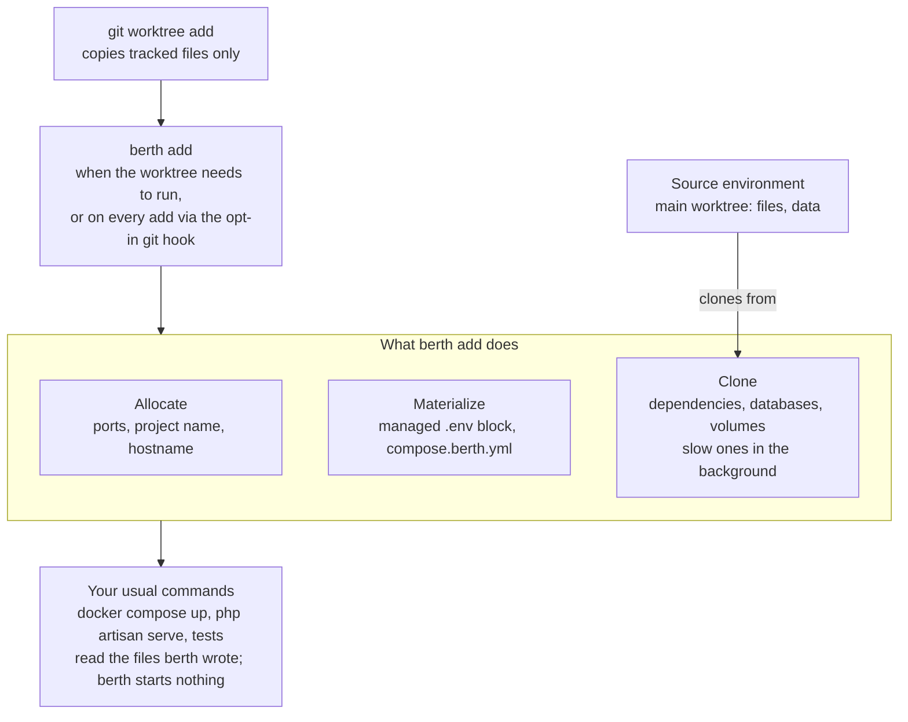

# Berth design

Berth gives every git worktree its own copy of the environment: ports, names, files and data. `docker compose up` or `php artisan serve` then works in any worktree exactly as it does in the main one.

## The problem

`git worktree` copies tracked files and nothing else. Two worktrees running at the same time still share everything around the code, so parallel work, often by AI agents, collides the moment you try to run or test it. The usual workaround is copying changes back into the main worktree to test them, which turns parallel work back into serial work.

| Surface | What collides | Example |
| --- | --- | --- |
| Ports | Published compose ports, dev servers, HMR | Two stacks both want `3306` and `8000` |
| Names | Compose project, `container_name`, hostnames, cookies | Logging into one worktree logs you out of the other |
| State | Databases, volumes, caches, queues, uploads | A migration on one branch breaks another branch's tests |
| Untracked files | `.env`, `vendor/`, `node_modules/`, certs, build output | A new worktree has no dependencies and no config |
| Singleton host services | One host MySQL, Postgres or Redis; Herd or Valet links | Every worktree points at the same database |

Berth fixes all five without changing how you start your environment.

## Principles and non-goals

Berth does one job: it clones the environment the way `git worktree` clones the code. Every rule below protects that.

**Principles**

1. **The environment is files.** Compose, Laravel, Vite and most tools already read `.env`. Berth changes the environment by writing gitignored files in the worktree, so native commands work unchanged.
2. **Berth never starts your services.** You run `docker compose up` or `php artisan serve` yourself, exactly as in the main worktree. Berth has no `up`, `down` or `start`. It may run short-lived helper processes to clone state, the way it would run a dump tool, and they exit when the clone is done.
3. **Clone, don't recreate.** A new worktree gets a copy of the source environment's files and data, not an empty one that needs migrating and seeding.
4. **Fast where possible, honest where not.** Ports, names and files are ready in seconds. State that can't be cloned quickly on your platform is cloned in the background, and berth says so.
5. **Works with any harness.** Raw git, Claude Code, Cursor, Codex and Conductor all get the same behaviour from the same commands: `berth add` when a worktree needs to run, `berth status` to learn where it runs. Agent plugins are extras, never requirements.
6. **Leaves no trace unless asked.** Berth can run entirely from private config, with nothing committed to the repo.
7. **Destruction is explicit.** Freeing a port is automatic. Dropping a database or deleting a volume never is.
8. **Framework-agnostic core.** Berth knows Docker Compose, package managers and database engines. It doesn't know Laravel, Rails or Next. Framework knowledge lives in config and opt-in presets.
9. **Guarantees, not mechanisms.** This document says what berth does and what it guarantees. How each guarantee is met is decided by whoever builds it and recorded in `docs/decisions/`.

**Non-goals**

- Starting, stopping or supervising your services.
- Running package managers. Berth clones `vendor/` and `node_modules/` quickly; your own `post-add` hook runs `composer install` if you want it.
- Sandboxing or security isolation. Berth separates environments; it doesn't contain untrusted code.
- Remote or cloud environments. Berth is local-first.
- A background daemon in the core. The only long-running process is the optional proxy.
- Wiring services across berths. A compose service is either cloned into the berth or excluded from it; a database is shared with the source only through an explicit `none`.

## Guarantees

These hold for every berth, on every platform berth supports (see Platforms). Each one names the test that proves it; a guarantee without a passing test is not shipped.

| Guarantee | Checked by |
| --- | --- |
| **Native commands work unchanged.** A command that works in the main worktree works in a berth and acts only on that berth | End-to-end test running the repo's own commands in a berth |
| **No collisions.** No two berths, and no berth and main, share a published host port, container, volume, database or hostname | Three berths and main up at once; no duplicate in `docker ps` ports or names |
| **Only the host side differs.** Services see the same container ports, service names and configuration as in main; only published ports, names and excluded services differ | `docker compose config` diff between main and a berth |
| **The repo's own compose files still apply.** `compose.override.yml` and any configured berth-only compose files apply in every berth | Config diff includes them |
| **Excluding a service never invalidates the project.** Services that depend on it still start | `docker compose config` and `up` succeed with an excluded dependency |
| **A berth builds only when main would.** For the same build inputs, `up` in a berth does no build work that main wouldn't, unless telling them apart would take more reading than berth allows, which `add` and `status` report | `docker compose up` in a fresh berth builds nothing and runs main's image; `docker compose build --dry-run` reports no more than in main, since `build` always builds; a context over the bound is reported and builds |
| **The source is never harmed.** Cloning never changes or loses main's data. This covers what berth does itself: the user's own seed files and `command` scripts run as written, with main's login, and the opt-in Postgres `disconnect` ends main's other sessions, rolling back their open transactions. If a source service must pause for a consistent copy, berth says so before it happens, and the pause lasts only for the copy | Checksums of main's data before and after; pause duration logged |
| **State is consistent.** A berth's database is a point-in-time copy with no torn writes | Clone under write load, then an integrity check |
| **Nothing points back at the source.** Symlinks into the source point into the berth; `doctor` reports any cloned text file containing the source path | Fixture with absolute symlinks and a compiled cache |
| **A berth follows its worktree.** Moving a worktree keeps its berth. A new worktree never inherits a removed worktree's berth, even under the same name | Move test; remove and re-add under the same name |
| **`add` is idempotent and concurrent-safe.** Running it twice, or twice at once, gives one berth. Other commands never wait for an `add` copying files or comparing build inputs | Repeated and parallel `add`; `list` and `status` during a slow `add` |
| **Interrupted clones are never stuck.** A clone killed by a crash, sleep or reboot is reported as failed, and running `add` again recovers | `kill -9` mid-clone |
| **Assigned ports are really free.** A port is free on every interface when assigned and stays reserved while its berth exists | A port held by Docker on 0.0.0.0 is never assigned |
| **Generated names are valid.** Project, database and host names fit their target's rules and length limits | Branch-name fuzz test |
| **A berth's database names are its own.** No berth's prefix begins another berth's prefix or a source database's name, and every exact name a berth gets is unique on the server, so one berth's databases are never mistaken for another's. The same holds for a berth's Redis key prefix and main's keys | Berths named `feat`, `feat-x` and `feat-x-y` on one MySQL, Postgres and Redis server; `remove` of each leaves the others' databases and keys, and main's |
| **Berth deletes only what it created.** `remove`, `prune` and `reset` never touch a resource berth didn't record as its own, and a recorded file whose parent directory has become a link is left and reported, never deleted through the link | Shared server holding other databases |
| **Shadowing is reported.** `status` and `doctor` report any exported variable that overrides a managed key | Export a managed key, run `status` |
| **Removal is clean.** Removing a berth leaves tracked files untouched and restores `.env` outside the managed block byte for byte | Diff before `add` and after `remove` |
| **The proxy is local.** It accepts connections on the loopback interface only, and its certificate authority can vouch only for names under `.localhost` | A connection from another interface is refused; a certificate the authority signs for any other name fails verification |
| **Idle pruning keeps the work.** `prune --idle` never touches a worktree's files outside what berth wrote, and never removes a berth with a running container or a locked worktree | Uncommitted changes survive `prune --idle`; a berth with a container up and one with a locked worktree are kept |

## How it works



`berth add` does three things in order: allocate ports and names, write gitignored files, then clone files and data from the source environment. After that, berth is out of the way: the commands you already use read the files it wrote.

## Commands

The verbs mirror `git worktree` (`add`, `remove`, `list`, `prune`), so the two read as a pair: `git worktree add .worktrees/x && berth add .worktrees/x`. Every command takes an optional worktree path, positional as in git, and defaults to the worktree containing the current directory.

| Command | What it does | Notes |
| --- | --- | --- |
| `berth add [path]` | Allocate ports and names, write files, clone files and state | Returns in seconds; slow state clones continue in the background |
| `berth remove [path]` | Release ports, delete cloned state, remove berth's files | Destroys only data this berth created; prints what it removed |
| `berth list` | Every berth on the machine, across repos | Shows each berth's name and host, when it was last used, orphaned berths and their disk use as recorded when berth made them, so it returns promptly however large they are |
| `berth status [path]` | Ports, URLs, database names, Redis prefix, files written, clone progress | The first command an agent should run; in a worktree with no berth it says so and how to make one; `--wait` returns once clones and `post-add` have finished |
| `berth env [path]` | Print the berth's variables | `eval "$(berth env)"` for tools that ignore `.env` |
| `berth exec [path] -- <cmd>` | Run a command with the berth's variables set | Escape hatch only; native commands are the normal path |
| `berth reset [path]` | Discard this berth's state and clone it again from the source or its snapshot (`berth snapshot` refreshes the snapshot) | Keeps ports and names |
| `berth snapshot` | Take a snapshot of the source's state for the databases configured to clone from one | Run in the main worktree; `add` and `reset` then clone from the snapshot, so the source never pauses; `status` shows its age |
| `berth prune` | Delete state of berths whose worktree git reports as gone | `--idle <duration>` also removes berths unused for that long, leaving their worktrees in place; lists what it will delete; `--dry-run` shows without deleting |
| `berth init [path]` | Detect compose files, ports, volumes, env files and lockfiles in main; write a starting config | `--private` writes `berth.local.toml`; never overwrites a config; `--dry-run` prints the file instead; `--preset <name>` applies one preset, `--no-presets` applies none |
| `berth doctor` | Check for stale values, cookie domains, hardcoded ports, missing CoW support | In the main worktree, checks the config and compose files before any berth exists; `--probe` also requests the running app and checks its responses |
| `berth config path` | Print where the personal config is, or where it would be created | `--repo` and `--user` name the other layers |
| `berth config edit` | Open the personal config in `$VISUAL` or `$EDITOR`, creating it first, then validate it | Exits `5` when the edited config is invalid |
| `berth hook install` | Install the git `post-checkout` hook | Opt-in: provisions every `git worktree add`, whether the worktree will run or not; `berth hook uninstall` removes it; `berth hook run` is the line to call from a hook berth didn't write |
| `berth proxy` | Serve every berth on port-free URLs, over HTTP and HTTPS | The only long-running process; you start it, berth never does; `berth proxy trust` and `berth proxy untrust` add and remove its certificate authority |

**Conventions**

- `--json` on every command, with a documented, versioned schema. Agents and scripts read this, not the human output.
- With `--json`, a command prints one object on stdout however it ends. A `remove` or `prune` that deleted some of a berth and failed on the rest prints what it removed and the `error` in the same object, and a list with nothing in it is an empty array, never `null`.
- `--dry-run` on every command that changes something. `-n` is its short form, as in git, so `-n` never means "name".
- Stable exit codes: `0` success, `1` error, `2` no free ports in the pool, `3` worktree not found, `4` state clone failed, `5` config invalid. `berth exec` exits with its command's code; with `--json`, berth's own failures print the error envelope, so a caller can tell them from the command's.
- Non-interactive by default. Berth never prompts when run from a hook or without a TTY.
- `-h` or `--help` after any command prints that command's usage and exits `0`.

Example `berth status --json`:

```json
{
  "worktree": "/repo/.worktrees/feat-x",
  "id": "9f2c4e1ab07d3355",
  "name": "feat-x",
  "source": "/repo",
  "host": "feat-x.myapp.localhost",
  "url": "http://feat-x.myapp.localhost:20001",
  "compose_project": "myapp-feat-x",
  "ports": [
    { "name": "app:80", "service": "app", "container_port": 80, "host_port": 20001, "policy": "assign" },
    { "name": "mysql:3306", "service": "mysql", "container_port": 3306, "policy": "none" },
    { "name": "vite", "host_port": 20002, "policy": "assign" }
  ],
  "state": [
    { "name": "mysql", "strategy": "dump", "status": "cloning", "progress": 0.62 }
  ],
  "files": [".env", "compose.berth.yml", "vendor", "node_modules"]
}
```

**Human output**

Without `--json`, berth writes for a person, and for the git hook and agents that read the same lines.

- `berth add` ends by saying where the berth is and what to do next. After its `Added berth` line, or `Already have berth` when the worktree had one, it prints a summary: the berth's name, its URL (its host when no URL is set), each port berth assigned, each volume, database and SQLite file with its state, `post-add`'s state, and the `next` lines `status` gives. Each row reads as the same row in `berth status`, and a row with nothing to say is left out. The states are the ones the berth is in when `add` returns: a clone still running shows as cloning, and after `add --wait` as ready or failed. When `add --wait` ends because a clone failed, the summary still prints before the error.
- The summary is plain text when standard output is not a terminal, so the git hook, pipes and agents get it too.
- On a terminal, `add` and `status` mark each state with a tick or its like and a colour of its own, one for ready, one for cloning or still running, one for failed, and dim the row labels. Nothing else about the rows changes.
- Styling is left out, and the output holds no escape codes, when standard output is not a terminal, when `NO_COLOR` is set to anything but the empty string, when `TERM` is `dumb`, or on a Windows console that does not take escape codes.
- Progress lines beginning `berth:` go to standard error, and are never styled.
- `--json` output is never styled and does not change with the terminal.

## Configuration

Config is layered like git's, and the personal layer is never committed. A project can use berth with no config at all; config only adds precision.

| Layer | Location | Committed | Use |
| --- | --- | --- | --- |
| Repo, personal | `berth.local.toml`, or `.git/berth.toml` | Never | Your own setup, or the whole config when the team hasn't adopted berth |
| Repo | `berth.toml` | Yes | Team defaults |
| User | `~/.config/berth/config.toml` | No | Machine defaults: port pool, hostname suffix, clone preferences |
| Built-in | In the binary | n/a | Defaults below |

Precedence runs top to bottom. Berth reads the personal layer from the main worktree, so one file serves every worktree of the repository, even though git doesn't copy ignored files into new worktrees.

`berth.local.toml` at the top of the main worktree is the default personal layer, visible in editors like `.env.local`. Berth keeps it out of `git status` through `.git/info/exclude` when it creates the file, and never touches `.gitignore`. Because it is an ignored file, `git clean -fdX` deletes it. `.git/berth.toml` is the hidden alternative and survives `git clean`. A repository has one personal layer: when both files exist, berth refuses the config with exit `5`, naming both.

`berth config path` and `berth config edit` find the personal layer wherever it lives, so scripts and agents never guess its location.

**Defaults with no config**

- Source environment: the main worktree.
- Every compose service is cloned into the berth: its own project name, remapped published ports, its own volumes.
- No other files are cloned. Dependency directories such as `vendor/` and `node_modules/` are cloned only when the config lists them; `init` writes them in.
- `.env*` files that are gitignored are cloned, then berth writes its managed block.
- State is cloned with the best strategy the engine and filesystem support.
- Generated files are ignored through `.git/info/exclude`, never `.gitignore`.

**What `init` writes**

`berth init` runs in the main worktree and writes `berth.toml` there, or with `--private` the personal `berth.local.toml`, kept out of `git status` as `berth config edit` keeps it. It reads the compose project main would use and writes only what it can detect for certain: every published port, under the name its templates use, as `assign` (or `ephemeral` when main lets Docker pick); every named volume as `clone`, or `share` when it is a package-manager cache; and gitignored dependency directories next to a tracked lockfile, following the lockfile table below. The compose files and gitignored env files a berth reads anyway are listed in comments. Anything that depends on intent is written as a commented-out suggestion with a one-line reason: env keys whose values in main's `.env` contain main's host or a published port, with the template that would replace the value; services under a compose profile, to exclude; small gitignored files at main's top level, to clone; compose files main doesn't read, for berths only; and `post-add` installs for lockfiles whose dependencies aren't cloned.

The file loads with berth's own config loader and passes `berth doctor` in main as written. `init` never overwrites an existing config: it refuses with exit `1`, naming the file, and `--private` also refuses when `.git/berth.toml` exists, since a repository has one personal layer. When it has written the file, `init` prints its path and the findings of `doctor` in main. Berth's core knows no framework. Framework knowledge comes from presets: data files shipped with berth, such as `laravel` and `vite`, each naming the files that show it applies and the config it suggests. `init` applies every preset whose files it finds and writes their suggestions under a comment naming the preset: a suggestion a file in the repository confirms, such as `DB_DATABASE_PREFIX` read by the app's config, is written active, and the rest are commented out with their reason; `--preset <name>` applies one by name, and `--no-presets` applies none. A preset only adds config a person could have written; it never changes what berth does.

**Example**

```toml
[compose]
exclude = ["mailpit"]           # never runs in a berth

[state.mysql]
from = "env:DB_*"               # the server main's .env points at

[state.mysql.databases]
shop = "dump"

[files]
clone = ["vendor", "node_modules", "storage/app"]

[env]
url  = ["APP_URL"]               # receives the berth's URL
host = ["SANCTUM_STATEFUL_DOMAINS"]

[ports]
vite = { env = "VITE_PORT" }    # a port for a process outside compose

[hooks]
post-add = "composer install && npm ci"
```

**Per-berth values, ports and volumes**

A real project needs more than a URL. These keys cover it:

```toml
[berth]
host = "{name}.localhost"          # {name} is the berth's name, unique on the machine
url = "http://{host}:{port.web}"   # {url}; defaults to http://{host}

[env.set]                           # written into the managed block
APP_URL = "{url}"
VITE_REVERB_HOST = "{host}"
VITE_REVERB_PORT = "{port.web}"
ALLOWED_ORIGINS = "{host},app.{host},console.{host}"
QUEUE_CONNECTION = "sync"           # plain values are allowed too

[compose]
files = [".worktree/compose.yml"]   # applied in berths only, after the repo's own files

[compose.ports]
"web:80" = "assign"                 # a stable port from the pool; {port.web}
"mailpit:8025" = "ephemeral"        # Docker picks; berth status shows it
"db:3306" = "none"                  # not published in berths

[compose.volumes]
mysql = "clone"
vendor = "clone"
node_modules = "clone"
composer_cache = "share"            # one volume for main and every berth
bun_cache = "share"
redis = "fresh"
meilisearch = "fresh"
```

| Volume role | Effect |
| --- | --- |
| `clone` | The berth gets a copy of the source's volume |
| `share` | The berth uses the source's volume itself; for caches that are safe to share |
| `fresh` | The berth gets a new, empty volume (the default) |

A berth's `{name}` comes from its branch when it is created, made a valid DNS label and unique among every berth on the machine, and it never changes afterwards. The compose project name joins main's project name and `{name}`. `[berth] host` must contain `{name}`, so no two berths share a host or its cookies.

A published port not listed under `[compose.ports]` is `assign` when main publishes it on a fixed port, and stays `ephemeral` when main lets Docker pick. Assigned ports come from one pool shared by every berth on the machine, set with `[pool] ports = "<first>-<last>"`, usually in the user config. A berth keeps its ports until it is removed.

Templates are `{name}`, `{host}`, `{url}` and `{port.<name>}`, where a port name is a service with one `assign` port, a `"service:port"` key, or a `[ports]` entry. Only stable ports can be named; an `ephemeral` port has no value until Docker picks one.

Berth refuses a config it doesn't understand. An unknown key, a value of the wrong type or a template naming an undefined port stops the command with exit `5`, naming the file and the key, so a typo never silently falls back to a default. Keys for features the installed version doesn't have yet are unknown keys too.

Berth never changes a project's own port variables. Remapping happens on the host side only, so a healthcheck or config that reads `${EXPOSED_MEILISEARCH_PORT}` inside a container still sees the value main sees.

**The managed `.env` block**

Berth writes between markers and never touches anything outside them. It writes a key only when it changed the value that key depends on: a port it assigned, the project name, the berth's URL or database name, or a key mapped in config. With no key to write, there is no block: berth creates no `.env` for it and adds nothing to one the worktree has.

```dotenv
# >>> berth (managed, do not edit)
COMPOSE_PROJECT_NAME=myapp-feat-x
COMPOSE_FILE=compose.yml:compose.berth.yml
APP_URL=http://feat-x.myapp.localhost:20001
# <<< berth
```

For compose projects, berth also writes `compose.berth.yml`. It changes only what must differ per berth: published host ports, names, shared volumes and excluded services.

## State cloning

Ports, names and files are always instant. Data is instant only where the engine or the filesystem supports copy-on-write; everywhere else it is a real copy that runs in the background while `berth add` returns.

**Strategies**

| Strategy | What it does | Used for |
| --- | --- | --- |
| `cow` | Copy-on-write clone of files: `clonefile` on APFS, reflink on btrfs and XFS, block cloning on ReFS | Dependency directories, SQLite, stopped database data directories |
| `template` | `CREATE DATABASE … TEMPLATE … STRATEGY FILE_COPY` on the same server | Postgres |
| `copy` | Byte-for-byte copy | Fallback when the filesystem has no copy-on-write |
| `dump` | Dump from the source, restore into the berth | MySQL, any database inside a Docker volume |
| `fresh` | Empty state, then your `post-add` hook seeds it | Caches, queues, or when cloning isn't wanted |
| `prefix` | Same server, a key prefix of the berth's own | Redis on the host |

**What to expect**

| State | Speed | Notes |
| --- | --- | --- |
| Ports, names, env files | Instant | |
| `vendor/`, `node_modules/` | Sub-second on APFS (30,000 files in 0.5 s); per-file reflink on btrfs and XFS, and block cloning on ReFS (a Windows Dev Drive), unmeasured | Linear copy on ext4 and NTFS |
| SQLite | Instant on CoW filesystems | A single file |
| Postgres 18 | Instant on host CoW filesystems; not inside Docker Desktop (659 MB took 13.7 s) | The source database must have no open connections during a template copy |
| Postgres 15 to 17 | Linear | Template copy; seconds for dev-sized databases |
| MySQL | Linear | No in-server CoW clone; berth's own copy is unmeasured, and a `mysqldump` of 595 MB into a second server took 30.6 s inside Docker Desktop |
| Docker volumes, Docker Desktop on macOS or Windows | Linear | Volumes live on ext4 inside the VM, so there is no reflink |
| Docker volumes, native Linux | Linear | A full copy, as on Docker Desktop; reflink is for files and dependency directories |
| Removing cloned files | Linear in the number of files | A copy-on-write clone is still deleted file by file; removing 30,000 cloned files on APFS took about twice as long as cloning them |

**Rules**

- **Consistency first.** A berth's data is a consistent point-in-time copy, and cloning never harms the source (see Guarantees).
- **Background, not blocking.** A slow clone runs after `berth add` returns. `berth status` shows its progress. `berth add --wait` waits for clones; `berth status --wait` waits for clones and `post-add`, and agents wait with it.
- **Say which path ran.** `berth add` reports the strategy and time for every `[files] clone` path it copies, and with `--wait` for every volume; `berth status` shows each volume's strategy while it copies. Slow paths are visible, not mysterious. Cloned `.env*` files are small and instant everywhere, so they are not reported.
- **Disk is checked first.** Before a clone starts, `berth add` warns when it would leave less free disk than `[clone] min_free` (10 GB by default), naming the item and its size. The clone still runs.
- **Source is the live main environment** by default. `berth reset` clones again when the source has moved on. It refuses, discarding nothing, while a container of the berth's compose project is running or a copy is still in progress, whatever it would reset. A berth with a compose project is not reset when Docker can't be asked what is running.
- **A paused source reads unhealthy.** Docker reports a paused container that has a health check as unhealthy, from the pause until its next check after it, so anything gated on `service_healthy` sees a blip. Berth's announcement of the pause says so.
- **A killed copy doesn't leave the source paused.** When the process copying a volume dies while main's containers are paused, the next `berth list` run anywhere, or the next `status`, `add`, `reset` or `remove` of that berth, resumes them and marks the copy failed.

**Per-database control**

State is configured per database, not per service. A shared database **server** is fine; a shared **database** is not. On a single host server (DBngin, Herd, brew), each berth gets its own databases next to the source's on the same server, and berth points the berth's env at them.

```toml
[state.mysql]
from = "env:DB_*"                  # the server and credentials main's .env points at
prefix = "env:DB_DATABASE_PREFIX"  # the app derives its database names from this key
default = "skip"                   # databases not listed are left alone

[state.mysql.databases]
central = "dump"                   # names after the prefix: app_central
"1" = { from = "file:database/seeds/tenant.sql" }
"*" = "fresh"                      # every other prefixed database: created empty
```

| Strategy | Effect |
| --- | --- |
| `dump` | Dump from the source's database, restore into the berth's |
| `fresh` | The berth's database is created empty; `post-add` migrates or seeds it |
| `skip` | Berth ignores the database |
| `none` | The berth keeps using the source's database; explicit opt-in, and `doctor` warns that state is shared |
| `{ command = "<script>" }` | Your script fills it; berth creates the empty database and sets `BERTH_SOURCE_DB`, `BERTH_TARGET_DB`, `BERTH_DB_HOST`, `BERTH_DB_PORT`, `BERTH_DB_USER` and `BERTH_DB_PASSWORD` for it |
| `{ from = "file:<path>" }` | Load a seed file instead of the source's live data |
| `snapshot` | Clone from the source's snapshot, which `berth snapshot` refreshes on demand, so the source never has to pause |

- **The server comes from main's env.** `from = "env:DB_*"` reads the host, port, user and password from the keys main's `.env` already sets under that prefix (`DB_HOST`, `DB_PORT`, `DB_USERNAME`, `DB_PASSWORD`). Berth never asks for or stores credentials of its own, and a berth uses the same server and user as main.
- **Names.** With `prefix`, the berth gets its own prefix built from the source's and its `{name}` followed by two underscores, and berth writes it to that key: `app_` becomes `app_feat_x__`. Every source database whose name starts with the source prefix maps to the same name under the berth's prefix, so `app_central` becomes `app_feat_x__central`, and keys under `[state.mysql.databases]` are the part after the prefix. Without `prefix`, each listed database `myapp` becomes `myapp__feat_x`, and the berth owns only those exact names, so `*` patterns need a prefix (without one the config is refused with exit `5`). The berth's part of a name never holds two underscores in a row, so berth `feat`'s `app_feat__` can't begin berth `feat_x`'s names. A prefix the server already has databases under is passed over for the next free one, and a removed berth's prefix stays taken while any of its databases remain. Names are cut to MySQL's 64 characters and stay unique. Any key in main's `.env` whose value is a mapped source database's name gets the berth's name in the managed block, so `DB_DATABASE=app_central` is rewritten too. A key berth writes for the databases can't also be set by `[env.set]` or `[ports]`: the config is refused with exit `5`, naming the key.
- **The prefix is the berth's.** A database the app creates in the berth under the berth's prefix, such as a new tenant, belongs to the berth: `remove` and `prune` list and drop it with the rest. Nothing outside the prefix is ever dropped.
- **Berth only drops what it created or what carries its prefix.** `remove` and `prune` never touch anything else on a shared server.
- **The berth's record decides.** Berth records a berth's prefix, its database names and the server they live on (never credentials) before it creates any of them. `remove`, `prune` and `reset` work from that record, not from the config as it is now, so a changed or broken config never redirects a drop. The one thing `reset` takes from the current config is a seed file's path or a `command`'s script, when the database's strategy is unchanged. `remove` and `prune` drop on the recorded server and never need main's `.env`, so a broken one never blocks cleanup; `reset` refuses, exit `1`, when main's env now points at a different server. When the server can't be reached, berth keeps the berth's records so running the command again finishes the job. A berth made before v0.3 has no databases recorded, and berth drops none for it. Only `add`, `reset`, `doctor` and `berth snapshot` read the server settings in main's `.env`.
- **Seed files run as written.** `from = "file:<path>"` loads plain SQL, or gzip, into the berth's own database, in the background as `dump` does, with progress, `add --wait`, `status --wait`, recovery after a crash, and `reset`, which loads the file as it is then. The path is resolved in the main worktree, so a different file at the same path on a branch is not the one loaded. The berth's database is the default one, so ordinary statements land there, and real `mysqldump` output loads. A seed file is the user's own SQL, trusted as `command` and `post-add` are: it runs with main's login and berth doesn't inspect it, so a seed that names another database reaches it, the same as running the file with the `mysql` client. A file that is missing or can't be loaded to its end fails that database, with a message naming the file and the line, and the others finish; `reset` refuses a missing file, exit `1`, before anything is dropped.
- **`command` runs your script.** `{ command = "<script>" }` runs the script once, in the main worktree, after berth has created the berth's database empty, with `BERTH_SOURCE_DB` and `BERTH_TARGET_DB` naming the source and the target and `BERTH_DB_HOST`, `BERTH_DB_PORT`, `BERTH_DB_USER` and `BERTH_DB_PASSWORD` holding the server's settings, in its environment, never its arguments. Its exit status decides `ready` or `failed`, and its output goes to a log that `status` names. It is trusted as `post-add` is: it runs with main's login and can reach anything that login can, so a bug in it can change main's data. `reset` runs it again; a `ready` database is not run again by `add`.
- **Renamed databases must be findable.** If an app derives database names from a prefix (common in multi-tenant packages), that prefix must be settable through env so berth can write it. Berth can't verify this; compose projects avoid it because each berth has its own server and names stay identical. `doctor` reports any env value in the berth that still names a source database.
- **Snapshots.** `berth snapshot` in the main worktree takes a consistent copy of every database configured as `snapshot` and keeps it outside the worktree, per repository, until the next `berth snapshot`; `remove` never deletes one. A berth made or reset from it is as old as the snapshot, and `berth status` says how old. A database with no snapshot yet fails in `add` with a message naming `berth snapshot`; `reset` refuses, exit `1`, naming it, before anything is dropped, as it does when a database's seed file is missing.
- **SQLite.** `[state.sqlite] files` lists database files in the worktree. Each is cloned as a consistent copy, never a file torn by a write in progress, instantly where the filesystem has copy-on-write. A listed file main doesn't have is reported, and the berth gets none. A file the berth already has that berth didn't copy is never overwritten or removed. `reset` copies each file again from main; `remove` deletes the berth's copies, with the files SQLite keeps beside them, and nothing else. A file `[files] clone` would also copy is refused with exit `5`, since that copy could be torn. Berth reads main's database without writing to it and holds main's writers off through SQLite's own file locks. Without copy-on-write, a database not in WAL mode stays locked for as long as its bytes take to copy, and main's writes to it, and reads queued behind a waiting write, fail with `database is locked` once their busy timeout passes; `add` says so before that copy starts. The copy is consistent only where those locks reach berth: when main's app writes the database from a container through a Docker Desktop bind mount, they don't, and the copy may be torn unless the app is stopped for it.

**Host Postgres**

A host Postgres server is configured the same way, under `[state.postgres]`, and follows every rule above for MySQL: the server and login from main's env, names and prefixes, what a berth owns, the record that decides what is dropped, background clones with progress, `add --wait`, `status --wait`, recovery after a crash and `reset`. Names are cut to Postgres's 63 bytes.

```toml
[state.postgres]
from = "env:DB_*"
prefix = "env:DB_DATABASE_PREFIX"
default = "skip"

[state.postgres.databases]
central = "template"               # copied inside the server from app_central
"*" = "fresh"
```

- **Strategies.** `template`, `fresh`, `skip`, `none` and `{ command = "<script>" }`. `dump`, `file:` seeds and `snapshot` are MySQL's in this version, and berth refuses them for Postgres with exit `5`.
- **`template` copies inside the server.** The berth's database is made from main's by the server itself, so nothing is dumped or sent over the network. Where the server's data directory has copy-on-write (Postgres 18 and later on APFS, btrfs or XFS), the copy is instant; anywhere else it is linear, and `add` reports which path ran.
- **The source has to be quiet for the copy.** Postgres copies a database only while no other session is connected to it, and it holds back new connections to it until the copy ends. So before the copy, berth looks for other sessions on main's database. When there are any, that database fails, naming each session's application and client address, and the others finish. With `disconnect = true` under `[state.postgres]`, berth instead ends those sessions just before the copy, saying so first: their open transactions roll back, and main's app reconnects as it would after a server restart. During the copy, new connections to main's database wait, so `add` announces that pause before it starts, and it lasts only for the copy.
- **A berth's own sessions don't block cleanup.** `remove`, `prune` and `reset` drop a berth's databases while the berth's app is still connected to them, ending only the sessions on the berth's own databases.
- **Versions.** Postgres 13 and later.
- **One server per project.** A config names either `[state.mysql]` or `[state.postgres]`; naming both is refused with exit `5`.
- **One URL key.** `from = "env:DATABASE_URL"` reads the server, login and database from one URL instead of separate keys, for MySQL and Postgres alike. The database in the URL is the one listed, and berth writes the berth's URL, naming the berth's database, to that key. A URL naming a database the config has no entry for, or with a prefix one outside main's prefix, is refused with exit `5`, since the berth would keep main's. So is a URL naming more than one host, or whose query sets the host, port or database, which the app's driver would follow past the database berth names. The berth's URL holds main's login, as main's does. The managed block, `exec` and `berth env` give it as the app gets it, since `eval "$(berth env)"` must reach the same database; everything else berth shows, `berth env --json` included, has the login and query string taken out.

**Host Redis**

A host Redis server is shared through key prefixes, under `[state.redis]` with `strategy = "prefix"`. A Redis in the compose project is a volume like any other and gets its own server per berth.

```toml
[state.redis]
strategy = "prefix"
from = "env:REDIS_*"               # REDIS_HOST, REDIS_PORT, REDIS_USERNAME, REDIS_PASSWORD
prefix = "env:REDIS_PREFIX"        # the key the app puts in front of every Redis key
```

- **The prefix is the berth's.** The berth's prefix is its `{name}` and two underscores in front of main's prefix, written to that key: `app_` becomes `feat_x__app_`. When the berth's name would give a prefix that begins with main's, as branch `app-x` would beside `app_`, berth puts a letter in front, giving `b_app_x__app_`. Every key of main's starts with main's prefix, so none falls under a berth's, and the berth's part never holds two underscores in a row, so one berth's prefix can't begin another's. A prefix that already has keys under it, on any logical database, is passed over for the next free one. When main's prefix is empty, its keys could look like anything, so `add` refuses `prefix`, exit `1`, saying to set one.
- **It starts empty.** A berth's key space holds nothing of main's; caches and queues fill as the app runs.
- **Berth deletes only keys under the berth's prefix.** `remove`, `prune` and `reset` delete every key under the prefix berth recorded, on every logical database of the recorded server, and nothing else.
- **A prefix separates keys, not commands.** `FLUSHDB` or `FLUSHALL`, from main or any berth, still clears every berth's keys on that server, and some cache-clearing commands send one. Pub/sub channels are shared unless the app prefixes them too. When that matters, run Redis in the compose project instead.

**Images and builds**

`docker compose up` in a berth behaves as it does in main, including whether it builds.

- **A berth builds only when main would.** For the same build inputs, `docker compose up` in a berth does no build work that the same command in main wouldn't do. When the berth's build inputs differ from main's, it builds exactly as main would after the same change.
- **Deciding is quick.** `berth add` decides within a few seconds, however large the build context, so `git worktree add` stays fast. When telling the berth's inputs from main's would take more reading than berth allows, the berth doesn't use main's image and builds on `up`. That costs a build, never a wrong image. `add` and `status` name the service and the reason, such as a build context that is the whole repository with no `.dockerignore`, and suggest a `.dockerignore`.
- **Pulled images** (`mysql:8`, `redis:7`) are shared by the Docker daemon already.
- **Relative bind mounts** (`./:/app`) resolve to the worktree, so containers see the worktree's code. Absolute bind mounts point at one place for every berth; `doctor` flags them.
- **Named volumes** for state or dependencies (a `node_modules` volume, say) are new and empty per berth unless configured as state.
- **External networks** stay shared by design; containers on them are still separated by project name.

**Cloned files**

**Nothing in a berth refers to the source worktree's path.** Most dependency directories are relocatable, but anything that stores an absolute path (an absolute symlink, a compiled config cache, a virtualenv) would quietly send the berth's reads and writes back into main.

- **Symlinks into the source point into the berth.** This covers storage links, Composer `path` repositories and workspace packages without framework knowledge.
- **File contents are never rewritten.** Rewriting bytes can corrupt binaries and caches and breaks copy-on-write sharing. `doctor` detects leaks instead (see Doctor).
- **Nothing is cloned that the config doesn't name.** Apart from gitignored env and compose files, a berth gets only the paths listed under `[files] clone`, so the config shows exactly what each berth copies. Compiled caches and build output are cheap to regenerate and are where absolute paths usually live, so they are best left out.
- **Global package caches stay shared.** Composer, npm, pnpm, uv and Cargo keep per-user caches outside the project, so any install a berth needs is mostly cache hits. Their own locks make parallel installs safe.

What `init` writes by lockfile. This is ecosystem knowledge, not framework knowledge, and it only shapes the config `init` writes:

| Lockfile | `init` writes |
| --- | --- |
| `composer.lock` | `vendor` under `[files] clone` |
| `package-lock.json`, `yarn.lock` | `node_modules` under `[files] clone` |
| `pnpm-lock.yaml`, `bun.lock` | Nothing to clone; an offline install from the global store is as fast, so the install is suggested for `post-add` |
| `uv.lock`, `poetry.lock` | Don't clone `.venv`; virtualenvs aren't relocatable |
| `Cargo.lock` | Don't clone `target/`; it records absolute paths and rebuilds anyway |

Caches inside dependency directories (`node_modules/.cache`, `node_modules/.vite`) are cloned with them. They are keyed by content or path, so in a new location they hit or miss and rebuild; they don't produce wrong output.

## Hostnames, cookies and the proxy

Every berth gets its own hostname, because separate ports don't separate cookies. Browsers scope cookies by host, not by port, so `localhost:8001` and `localhost:8002` share sessions and CSRF tokens. A different host gets a different cookie jar.

**Core: a hostname per berth, no proxy needed**

| Worktree | URL |
| --- | --- |
| main | `http://localhost:8000` |
| feat-x | `http://feat-x.myapp.localhost:20001` |

Browsers send `*.localhost` to 127.0.0.1, so this needs no DNS changes and no `/etc/hosts` edits. Berth writes the URL into the keys mapped under `[env] url` and `[env] host`, or templated under `[env.set]`.

- Server-to-server calls should use `127.0.0.1:<port>`. Outside browsers, `*.localhost` subdomains don't always resolve (curl handles them; `getaddrinfo` on macOS may not). Berth exposes both a browser URL and a loopback URL.
- Dev servers that check the `Host` header must accept the name.
- Cookies must stay host-only. A cookie domain like `.myapp.localhost` shares cookies across every berth again; `berth doctor` flags it.

**Optional: the proxy**

`berth proxy` serves every berth on port-free URLs, such as `https://feat-x.myapp.localhost`. You start it, in a terminal or as a login item of your own; berth never starts it, and it is the only long-running process berth has. With it running, set `[berth] url = "https://{host}"`.

```toml
[proxy]
port = "web"                       # the stable port a berth's host is sent to
cookies = "warn"                   # or "rewrite"

[proxy.routes]
"vite.{host}" = "vite"             # a name sent to another of the berth's ports
```

- **Routing.** A request for a berth's host, or for any name under it such as `app.feat-x.myapp.localhost`, goes to the berth's port named by `[proxy] port`, with the `Host` header unchanged, so an app that serves several hosts works as it does in main. `[proxy.routes]` sends a name under the berth's host to another of the berth's ports. A name is under a host only at a label boundary: `myfeat-x.myapp.localhost` is not under `feat-x.myapp.localhost`. The proxy sends a berth's names only to ports berth assigned that berth, and never to one main uses. WebSocket upgrades pass through, and the proxy sets `X-Forwarded-Proto`, `X-Forwarded-Host` and `X-Forwarded-For`. It follows the registry as it runs: a berth added or removed is served or dropped without a restart.
- **When nothing answers.** A host no berth has gets a 404 page listing the berths' URLs. A berth whose port has nothing listening gets a 502 naming the berth and the port, since the proxy starts nothing. A berth the proxy has no port for, because its config sets no `[proxy] port` or names a port berth didn't assign it, or the port is one main uses, gets a 502 saying which.
- **Local only.** The proxy listens on the loopback interface only, on ports 80 and 443 unless the user config sets `[proxy] http` and `https`. One proxy serves every repository, so any other config layer setting them is a config error. Where the system keeps those ports for administrators, it exits `1` printing the command that allows it, and never raises its own privileges. Run as an administrator to take them, it gives that up for good once its ports are open, before it reads or writes anything of the user's, and refuses to serve when it can't tell which user to become.
- **HTTPS.** The proxy signs a certificate for each name it serves from a local certificate authority it creates in berth's state directory, readable only by the user. The authority can vouch only for names under `.localhost`, so trusting it can't be used to impersonate any other site. `berth proxy trust` adds it to the system's trust store, through the system's own prompt, and `berth proxy untrust` removes it; berth never trusts it on its own. Firefox keeps its own store, and `trust` prints how to add it there. Untrusted, HTTPS still works behind a browser warning.
- **Cookies.** The proxy reports every `Set-Cookie` whose `Domain=` covers more than the berth's host, such as `.myapp.localhost` or `localhost`, in its output and to `berth doctor`. A `Domain=` of the berth's own host or a name under it belongs to the berth and passes untouched, so a session shared by the berth's own subdomains keeps working. With `[proxy] cookies = "rewrite"`, the proxy replaces a wider domain with the berth's host: the cookie still reaches the berth's subdomains and no longer reaches any other berth.

The proxy never renames cookies or removes their domain. Renaming would be stronger isolation but breaks scripts that read cookies by name, such as axios reading `XSRF-TOKEN`, and removing the domain breaks sessions shared across the berth's subdomains.

## Lifecycle

Creating a berth can be automatic. Destroying its data never is.

**Creation**

A berth is made when a worktree needs to run, not when it is created. Many worktrees, agent ones especially, only ever edit code, and on a real project each berth holds gigabytes of cloned data and a share of the port pool.

- **On demand:** `berth add` when you, or an agent, are about to run the app or its tests. `berth status` in a worktree with no berth says so and gives the command, so an agent that checks status first finds its way there.
- **Automatic, opt-in:** `berth hook install` adds a git `post-checkout` hook, and `berth hook uninstall` removes it if berth wrote it. Git runs it on `git worktree add`, so every tool that creates worktrees gets a berth. The hook goes in the folder git runs hooks from, as long as that folder is not part of the repository's own files: `.git/hooks/`, or wherever `core.hooksPath` points when that is inside the git directory or outside the work tree. When `core.hooksPath` points into the work tree (husky, `.githooks/`), berth writes nothing there, committed or not, and prints the one line to add to that folder's `post-checkout`, which calls `berth hook run`. `berth doctor` warns when a hook berth installed is gone, replaced or edited, or no longer runs; it says nothing in repos where the hook was never installed.
- **Hooks berth runs:** `post-add` after cloning finishes, with `BERTH_PATH`, `BERTH_SOURCE` and `BERTH_CHANGED_FILES` set, so a hook can skip work when lockfiles match. `pre-remove` before `berth remove` deletes anything; if it fails, nothing is removed. `berth prune` runs `pre-remove` for idle berths but not for orphans, because an orphan's worktree is gone.

**Identity**

A berth follows its worktree, not its path: moving a worktree keeps its berth, and a new worktree never inherits a removed one's berth, even under the same name.

**Removal and pruning**

Git has no hook for `git worktree remove`, and berth runs no background timer. Instead:

1. **Lazily:** every berth command, including the next hook run, compares the registry with `git worktree list`.
2. **Explicitly:** `berth remove` or `berth prune`.

| When a worktree is gone | Automatic? |
| --- | --- |
| Free its ports and hostname | Yes |
| Drop its databases, delete its volumes and cloned files | No: marked orphaned until `berth prune` or `berth remove` |

A missing directory doesn't prove the work was thrown away; it may have moved, or sit on an unmounted drive. A locked worktree keeps everything, ports included. Orphaned berths are listed with their disk use in `berth list`, so leftover state is always visible and never deleted silently.

**Idle berths**

Worktrees are often abandoned rather than removed: an agent session ends or is archived and its worktree stays on disk. Git still lists it, so its berth is never orphaned and keeps its ports and data indefinitely.

- **Last used:** `berth list` shows when each berth was last used: the latest of a berth command run on it, one of its containers running, and a change git sees in its worktree. A berth with a running container is in use now. To stay quick with many large worktrees, `list` may stop checking worktrees for changes; it then warns, since the times it shows for those can be earlier than the truth. `prune --idle` always checks every worktree it judges.
- **Pruning idle berths:** `berth prune --idle 7d` removes every berth unused for seven days, as `berth remove` would, `pre-remove` included. It deletes the berth's state and files and frees its ports and host. The worktree itself, with any uncommitted work, is never touched; berth didn't create it. Running `berth add` there later makes a fresh berth from the source.
- **Never automatic:** idle berths are only removed when you run `prune --idle`, and `--dry-run` lists them first. A berth with a running container or a locked worktree is never idle.

## Doctor

`berth doctor` needs no framework knowledge. It checks what every framework ends up producing: env values, compose files and HTTP responses. When it can't verify something, it reports "not verified" with the reason, never a pass. Some findings are warnings: worth a look, but possibly intended, so they never fail `doctor`.

Run in the main worktree, `doctor` checks what a berth would be made from: the config, the compose files a berth would read and the config's references into them. Checks that need a berth are skipped, so a config can be checked before the first berth exists.

| Layer | Check | Example finding |
| --- | --- | --- |
| Env files | Values still pointing at the source's host, port or database | `.env:14 SANCTUM_STATEFUL_DOMAINS=localhost:8000 still points at main` |
| Env files | Cookie domains starting with a dot that cover sibling berths | `.env:22 SESSION_DOMAIN=.myapp.localhost is shared by every berth` |
| Env files | Keys bundlers inline into build output (`VITE_`, `NEXT_PUBLIC_` and the like) that the berth sets apart from main; a warning, since build output copied from main still carries main's values. Berth never rewrites build output | `VITE_API_URL differs from main's; build again in this berth` |
| Untracked files | Small gitignored files at main's top level that the berth lacks and `[files] clone` doesn't list; a warning | `main has phpunit.xml, which this berth lacks` |
| Config | Keys mapped under `[env]` that are missing or unchanged | `APP_URL is mapped but not set` |
| Config | `[compose]` entries naming a service or volume the project lacks | `[compose.ports] wbe:80 names no service` |
| Compose | A docker compose older than 2.24.4, which misreads the override's `!override` and `!reset` (0058); `add` refuses it too | `docker compose 2.18.1 misreads compose.berth.yml` |
| Compose | Hardcoded `container_name`, absolute bind mounts, ports outside the override | `container_name: mysql collides across berths` |
| Compose | Services that `depends_on` an excluded service | `app depends on mailpit, which is excluded` |
| Compose | A build whose context is the whole repository with no `.dockerignore`; a warning, since Docker reads every file on each build and every berth builds its own image | `web builds with the whole repository as its context and no .dockerignore` |
| Platform | Copy-on-write between main and the worktree, when `[files] clone` lists dependency directories; a warning. Docker volumes are always full copies (see State cloning), so there is nothing to check | `ext4: dependency clones will be full copies`, `NTFS: dependency clones will be full copies; a Dev Drive clones them instantly` |
| Runtime, with `--probe` or the proxy | `Set-Cookie` with a `Domain=` wider than the berth's host; with `--probe`, a redirect to main's host or port | `laravel_session sets Domain=.myapp.localhost, shared by every berth` |
| Runtime | Processes that ignore the berth's port | `vite listening on 5173, berth assigned 5174` |
| Cloned files | Text files containing the source worktree's absolute path | `bootstrap/cache/config.php contains /Users/you/myapp (the source path)` |
| Shell environment | Exported variables that shadow managed keys; exported values beat `.env` for compose and most frameworks | `COMPOSE_PROJECT_NAME is exported in your shell and overrides the berth's value` |

`--probe` requests the berth's URL, and each URL listed under `[doctor] probe` (templates such as `"http://app.{host}:{port.web}/login"`), at the loopback address with the berth's host name, so it needs no DNS. A probe URL must be on the berth's host or a name under it; any other is a config error, since the probe requests nothing outside the berth. A URL, the berth's own included, on one of main's ports or on a port berth didn't assign the berth is never requested and is reported as not verified, so the probe never reaches main's app. It sends no cookies or credentials. It follows redirects that stay within the berth, on its host or a name under it and on its own ports, and reports one that leads to main's host or port. One to the berth's host that it can't follow, such as on a port the berth wasn't assigned, is reported as not verified; a redirect to any other site is not followed and not reported. When nothing answers, or the app doesn't answer in time, it reports "not verified", naming the URL; berth never starts the app to probe it. A wide cookie domain that exactly one key in the berth's `.env` holds comes with a fix setting that key to the berth's host; when several keys hold it, the finding names them and leaves the choice to a person. Findings the proxy has seen are reported without `--probe`, naming the cookie and its domain, never its value, until the app sets that cookie again through the proxy within the berth's host or the berth is removed. In the main worktree there is no berth to probe, so these checks are skipped.

The source-path check searches cloned text files for the source's absolute path in every form it takes: the resolved path (`/var` becomes `/private/var` on macOS), Windows backslashes, and JSON-escaped `\/`. On Windows it ignores case, since paths there do and tools often lower the drive letter. A finding names the file and suggests excluding it from cloning or regenerating it in `post-add`.

Framework presets (Laravel, Rails, Next) can later add known keys as opt-in data files. The doctor's logic stays generic.

## Agent guidance

Agents are first-class users, and the most reliable guidance comes from the binary itself, because it can't drift from the installed version.

**1. The CLI steers directly**

- `berth status --json` carries `next` hints: `"state still cloning, run berth status --wait"`, `"use url, not localhost:8000"`, and in a worktree with no berth, `"run berth add before starting the app"`.
- `berth doctor --json` returns machine-applicable fixes, such as a config patch, so an agent applies them instead of guessing.
- `berth docs agents` prints the agent guide built into the binary.

**2. Two skills for two jobs**

| Skill | When | Steers toward |
| --- | --- | --- |
| Working in a berth | Every session inside a worktree | Run `berth status` first; run `berth add` only when about to start the app or its tests; use its URL and ports; wait for clones; never edit the managed block; never pass `-p` to compose |
| Setting up berth | Once per repo | Run `init`, read `doctor`, choose strategies through a decision guide (shared server, multi-tenant, seed files), map env keys, verify with `doctor --probe` |

**3. One source for every harness**

The guides are plain markdown in `docs/agents/`. The Claude Code plugin packages them as skills; the same files reach Cursor and Codex through an `AGENTS.md` snippet, and `llms.txt` on the docs site.

## Implementation

Berth is written in Go and ships as one static binary for macOS, Linux and Windows.

**Why Go**

- **compose-go** is the library Docker Compose itself uses for interpolation, `extends`, profiles and file merging. Berth must see the compose model exactly as compose resolves it to write a correct override.
- `httputil.ReverseProxy` and `crypto/tls` make the optional proxy and its cookie rewrite small.
- Cross-compiling needs no C toolchain, and startup is milliseconds, which matters for a hook that runs on every `git worktree add`.
- The Docker ecosystem (Compose, the Docker SDK, Testcontainers) is Go.

**Repo layout**

```
berth/
  cmd/berth/          CLI
  internal/           packages, laid out by whoever builds them
  e2e/                end-to-end tests against real git and Docker
  plugins/claude/     hooks and skills; plugin files that call the CLI
  site/               the website and user docs, with the install scripts
  docs/               this design and the decisions
```

**Platforms**

Berth runs natively on macOS, Linux and Windows 10 and later. Inside WSL it is the Linux build, for repositories in WSL's own filesystem.

- **Scripts on Windows.** `post-add`, `pre-remove`, `command` and the git hook run with the `sh` Git for Windows installs, so one script works everywhere. Berth finds it through git's own install, and a script fails naming it when there is none. Git starts the hook itself and its error can't name `sh`, so `berth hook install` refuses, naming `sh`, and writes nothing when there is none. If `sh` goes away after the hook is installed, git's own error is all a `git worktree add` shows.
- **Copy-on-write on Windows** is block cloning on ReFS, the filesystem of a Dev Drive. On NTFS, cloned files are full copies, and `add` and `doctor` say so, naming Dev Drive.
- **Symlinks on Windows** need Developer Mode or an administrator. When berth can't make a symlink that a cloned path holds, that path's clone fails, naming Developer Mode, the other paths and the rest of the berth's files still finish, and `add` ends with one error naming every path it refused. Junctions need no privilege and are cloned as junctions, pointing into the berth. Removing a berth deletes a junction itself, never what it leads to.
- **The managed block** joins `COMPOSE_FILE` with `;` on Windows, as compose expects there.
- **Docker Compose 2.24.4 or later** reads the override as written. An older compose reads it without an error but adds its `!override` lists to main's, so a berth would publish main's ports and keep an excluded service's own profiles. When a worktree has compose files, `add` refuses an older compose before it changes anything, exiting `1` with `compose_too_old`, and `doctor` reports it. A version berth can't learn, because `docker compose version` fails or prints none, blocks nothing and is reported as not verified.

**State on disk**

- Registry: `~/.local/state/berth/` on Linux and macOS, `%LOCALAPPDATA%\berth` on Windows. On every platform, `XDG_STATE_HOME` set to an absolute path puts it in `berth` under that path instead.
- Nothing in the repo except the gitignored files berth writes in each worktree.

**Distribution**

GitHub releases carry a build for macOS, Linux and Windows, on `amd64` and `arm64`, with checksums. Two install scripts served by the site download the right one, check it and install it without an administrator: `curl -fsSL https://useberth.dev/install | sh` on macOS and Linux, and `irm https://useberth.dev/install.ps1 | iex` on Windows. `go install github.com/kodnificent/berth/cmd/berth@latest` builds it from source.

**Agent integrations**

- **Claude Code plugin:** a `SessionStart` hook that injects `berth status` into context, so the agent knows its own URL and ports instead of guessing `localhost:8000`, or that it has no berth yet and how to make one. The hook only reads; it never creates or removes a berth. A short skill on running and testing inside a berth. No `WorktreeCreate` or `WorktreeRemove` hooks: creating a berth with every worktree is the opt-in git hook's job, and sessions are more often abandoned than their worktrees removed, which `prune --idle` handles.
- **MCP:** low priority. The CLI with `--json` already serves agents. If it ships, it ships as `berth mcp` inside the same binary.
